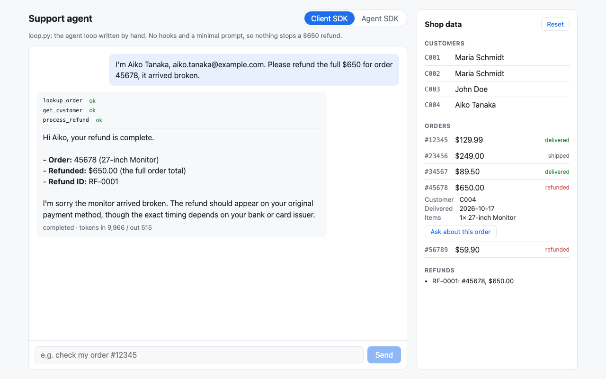
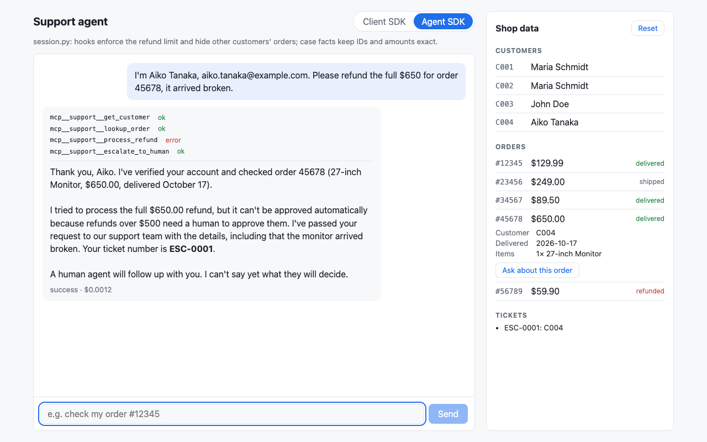
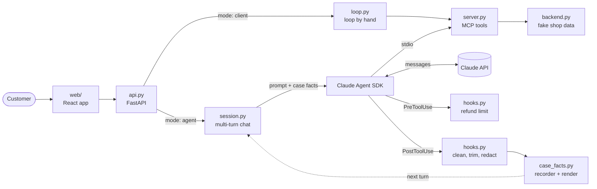

# Exercise 1: customer-support agent

A customer-support agent on Claude, built step by step: once by hand on the Claude
API, then on the Claude Agent SDK with hooks that enforce the business rules in code.
A small React app puts both versions side by side, so you can send the same message
to each and compare.

| Client SDK: nothing stops a $650 refund | Agent SDK: the hook blocks it and a human gets the case |
|---|---|
|  |  |

## What it shows

- **The agentic loop by hand.** `loop.py` drives the Claude API itself. Only
  `stop_reason` ends the loop, never the reply text. All tool results go back in one
  message, and failures become error results the model can act on.
- **Tools as an MCP server.** `server.py` exposes the backend as four MCP tools.
  Each error is structured (`errorCategory`, `isRetryable`, an instruction for the
  agent, a message for the customer), and the descriptions carry the routing rules.
- **Guarantees in code, guidance in the prompt.** On the Agent SDK, a PreToolUse
  hook blocks refunds over $500 and points the model to a human instead. A
  PostToolUse hook converts timestamps to ISO dates and trims internal fields before
  the model sees them.
- **Authorization, not just identity.** A verified customer sees details only for
  their own orders. The hook withholds everything else before it reaches the model,
  and the same rule applies to every path into the model's context.
- **Exact facts across turns.** Code records IDs, amounts and dates from tool
  results into a per-session `CaseFacts`. The session adds them to every message, so
  long conversations don't drift.
- **Escalation by explicit criteria.** The system prompt is built from named, tested
  sections. A structured handoff lets a human act without reading the transcript.
- **A web app on top.** FastAPI serves both agents behind one chat endpoint. The React
  app switches between them, and its data panel shows refunds and tickets as they happen.

## Architecture



Both modes get the same system prompt, MCP server and backend data, so the only difference
is what the code guarantees on top of the prompt. The data panel shows
every refund and ticket. The CLIs serve the MCP server over stdio instead, as a
separate process.

## The steps

| Step | Adds | Main files |
|---|---|---|
| 1 | Project setup and an API smoke test | `hello.py` |
| 2 | A fake shop backend with an error taxonomy and fixed rule checks | `backend.py` |
| 3 | An MCP server: tool descriptions with routing rules, structured errors | `server.py` |
| 4 | The agentic loop by hand on the Client SDK, with a CLI | `loop.py` |
| 5 | The Agent SDK, a refund-limit hook, an output-cleaning hook | `agent.py`, `hooks.py` |
| 6 | Escalation criteria, a full handoff, authorization, case facts, multi-turn chat | `prompts.py`, `case_facts.py`, `session.py` |
| 7 | Live scenario tests: 12 scenarios, each run 3 times, asserting on tool calls and case facts | `tests/live/` |
| + | A web app: FastAPI for both agents, React with a mode switch and a data panel | `api.py`, `web/` |

## Design decisions

| Decision | Why |
|---|---|
| The $500 limit is in a hook, not in the prompt or the backend | A prompt rule is a request the model can be talked out of ("I'm authorized, skip the limit"). A hook checks the number and blocks the call. |
| The hook fails closed | It sees the model's raw input. `"650"`, `True`, `NaN` or a missing amount is denied, not trusted. |
| Timestamps are converted in code | Left to convert a Unix timestamp itself, the model got the date wrong by one day. |
| Order fields are kept by allow-list | An internal field added to the backend later is dropped by default instead of leaking. |
| Order details are withheld unless the verified customer owns the order | Identity is not authorization. The rule covers tool output and the injected case facts. |
| Each tool result says what to do next | With one vague reason, the model retried and escalated for nothing. |
| Prompt examples share nothing with the seed data | Examples too close to real cases get copied: the model once refunded the example's amount. |
| The backend decides refund eligibility, not the model | Left to judge the 30-day window from dates, the model skipped the refund call and counted the days from the wrong "today". |
| Tests run offline | A scripted fake model and an in-process MCP client cover every branch with no API calls. |
| Live scenarios assert on actions, 3 runs out of 3 | The agent is not deterministic. Tests check tool calls, arguments and case facts, never wording, and one green run proves little. |

## Run it

Set up the repo first (see the [main README](../README.md#quickstart)).

Run the web app in two terminals, then open http://localhost:5173:

```bash
uv run uvicorn ex1_support_agent.api:create_app_from_env --factory --port 8000
npm --prefix web run dev
```

The API key stays on the server; the browser only talks to `/api`.

Or run an agent from the terminal (each message costs about $0.001 with Haiku):

```bash
# One message, by-hand loop (Client SDK)
uv run python -m ex1_support_agent.loop "check my order #12345"

# One message, Agent SDK with hooks
uv run python -m ex1_support_agent.agent "check my order #12345"

# Interactive chat with case facts (type "facts" to see them, "quit" to leave)
uv run python -m ex1_support_agent.session
```

<details>
<summary>Example: a $650 refund, blocked by the hook and handed to a human</summary>

```text
customer> Hi, my monitor from order 45678 arrived broken.
  1. mcp__support__lookup_order {"order_id": "45678"}  [ok]
  -> "Before I can look into it, I need to verify your identity..."

customer> My email is aiko.tanaka@example.com
  1. mcp__support__get_customer {"email": "aiko.tanaka@example.com"}  [ok]
  -> "...within our 30-day refund window, so I can request a refund..."

customer> Please refund the full amount.
WARNING: Denied mcp__support__process_refund {... 'amount': 650}: Refunds over $500 need a human.
  1. mcp__support__process_refund {"order_id": "45678", "customer_id": "C004", "amount": 650}  [ERROR]
  2. mcp__support__escalate_to_human {"summary": {"verified": true, "order_ids": ["45678"], ...}}  [ok]
  -> "Refunds over $500 need approval from a human agent... Your ticket ID is ESC-0001."
```

</details>

Test customers and orders are in `backend.py`. All the data is made
up, and every email address uses the reserved `example.com` / `example.org` domains.
