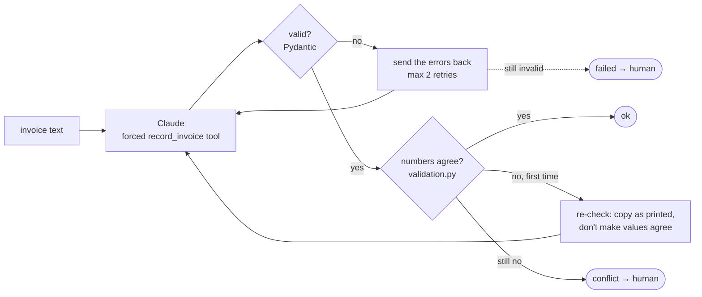

# Exercise 2: structured extraction

An invoice extraction pipeline on the Claude API. Claude reads an invoice and fills a
typed record through a forced tool call; code validates the record, checks that its
numbers agree, retries only what a retry can fix, and hands the rest to a human. Every
change to the prompt or schema is measured against hand-written ground truth.

## Results

12 fictional invoices, each built around one edge case, 12 fields each, 3 runs per
configuration (432 field checks). Model: Claude Haiku 5.5.

| Configuration | Correct fields | Input tokens per document |
|---|---|---|
| Zero-shot baseline (Step 2) | 421 / 432 | — |
| + money schema, semantic checks, retries (Step 3, variant A) | 426 / 432 | 2,205 |
| + field descriptions (variant B) | **432 / 432** | 3,046 |
| + three few-shot examples (variant C) | 431 / 432 | 3,522 |
| Variant B through the Batches API, at half price (Step 5) | 132 / 132 | — |

- Errors that repeated in 3 of 3 runs were treated as systematic and fixed at the
  source; one-off misses were treated as noise.
- Field descriptions fixed the remaining systematic error (catering filed as
  `services`, 3 of 3 runs → 0 of 3). Few-shot examples added no accuracy on top and cost
  about 480 more input tokens on every call, so variant B is the one kept.
- inv_07, whose line items really don't add up to its printed total, ends as a
  `conflict` for a human in every run, with the printed total kept, not "corrected".

## How it works



Three different questions, answered in three places:

| Question | Answered by | Needs ground truth? |
|---|---|---|
| Is the output well-formed? | `schema.py` (Pydantic, `extra="forbid"`, cross-field rules) | no |
| Do its numbers agree? | `validation.py` (item arithmetic, items vs subtotal, subtotal + tax = total) | no |
| Is it what the document says? | `scoring.py` (per field: fabrication, omission, wrong) | yes, evaluation only |

The first two run in production. The third is how changes are measured: the catering
error passed both production checks and only the evaluation caught it.

## The steps

| Step | Adds | Main files |
|---|---|---|
| 1 | The invoice schema, 12 invoices covering 12 edge cases, hand-written ground truth (no API) | `schema.py`, `corpus/`, `ground_truth.py` |
| 2 | An extraction tool with forced `tool_choice`, a zero-shot baseline, field-level scoring | `extractor.py`, `scoring.py` |
| 3 | A tighter money schema, semantic checks, retries only where a retry can help | `schema.py`, `validation.py`, `pipeline.py` |
| 4 | Field descriptions and few-shot examples, measured one change at a time | `schema.py`, `variants.py`, `compare.py` |
| 5 | The Message Batches API: one batch, results matched by custom_id, a second batch for what failed | `batch.py` |

## Design decisions

| Decision | Why |
|---|---|
| Absent fields are required but nullable | The model must address every field, and "not in the document" has an honest answer (null) instead of a made-up tax ID. |
| Money is `Decimal`, never `float` | `129.99` as a float is `129.98999…`; totals must compare exactly. |
| Subtotal, tax and total are separate fields, each as printed | With only a total, every VAT invoice looks like its items don't add up. Code compares the printed values; the model never computes or "fixes" them. |
| Currency is an ISO 4217 pattern (`^[A-Z]{3}$`), not an enum | Codes are a closed format, not a business taxonomy. A CHF invoice stays CHF instead of being forced into EUR. |
| Unknown keys are rejected | A typo like `vendor_taxid` would otherwise look like a missing tax ID. |
| Ground truth records what the document says | For an invoice whose items don't add up, the expected total is the printed one. Spotting the gap is code's job. |
| Corpus files have neutral names (`inv_01.txt`) | A name like `no_tax_id.txt` would leak the answer if it ever reached a prompt. The edge cases live in `ground_truth.json`. |
| The schema is the tool's `input_schema`, and the named tool is forced | One schema, and every document must produce an extraction. The API accepts Pydantic's `$defs`/`$ref`. Forced tool choice works on Haiku 5.5; Opus 5.5 and Sonnet 5.5 reject it, so there it would be `auto` with `strict: true`. |
| Tool input is validated again with Pydantic | The tool forces the shape, not the meaning: JSON Schema can't express "a detail only for `other`". |
| Mismatches are classed as fabrication, omission or wrong | Each points to a different fix. A fabricated tax ID is worse than a missed one. |
| Money is a number or a plain decimal string, in the schema and in the parser | The model sees the format up front, so `"1.037,58"` and `"null"` break the schema it was given. The parser enforces the same pattern on what comes back. |
| Invalid input is retried, inconsistent numbers are re-checked once, absent values never | A retry fixes a misread. It can't add information the document lacks, or fix a document that doesn't add up. |
| The re-check tells the model not to make values agree | Otherwise it "repairs" inv_07's printed total to the sum of its items: a fabrication that passes validation. A document that still disagrees ends as a conflict for a human. |
| Fields that change on the re-check are recorded (`changed_on_recheck`) | Code can't tell a fixed misread (1400 → 1440) from a fabricated fix (1203 → 1163): both make the numbers agree. Provenance lets a human audit it. |
| Descriptions and few-shot examples are separate variants (A → B → C) | One change at a time, or the effect can't be attributed. |
| Prompts, descriptions and examples share nothing with the corpus | A test checks every model-facing text for corpus vendors, numbers, products and tax IDs, and for "catering". Otherwise the score measures memory, not extraction. |
| Free text is scored by what downstream needs | Identifiers, dates, codes and numbers are exact. Vendor names ignore case, item descriptions aren't scored, and `category_detail` counts presence. Otherwise copying `KESTREL NETWORKS CORP.` as printed would score as an error, and real changes would hide in the noise. |
| Batch results are matched by `custom_id`, never by position | Results come back in any order. The custom_id is the document name without `.txt`, because the API allows only letters, digits, `_` and `-`. |
| Batch retries are a second batch, not a loop | A batch request gets one answer. Errored requests are fixed and sent fresh; invalid and inconsistent extractions go back with the Step 3 feedback (document, failed output, specific errors). |

## Run it

Set up the repo first (see the [main README](../README.md#quickstart)). These commands
call the real API; one full run costs a few cents with Haiku.

```bash
uv run python -m ex2_extraction.extractor              # zero-shot baseline: 3 runs x 12 documents, saves runs/baseline.json
uv run python -m ex2_extraction.pipeline --variant B   # with checks and retries: saves runs/B_1..3.json
uv run python -m ex2_extraction.compare A B C          # the variants side by side, re-scored from runs/
uv run python -m ex2_extraction.batch                  # 11 requests (one broken on purpose) as a batch, then a second batch
```

The tests (`tests/test_ex2_*.py`) run offline against scripted fake responses.

## The corpus

| Doc | Edge cases | The trap |
|---|---|---|
| 01 | clean table | none: the baseline |
| 02 | narrative email | quantity, rate, due date and tax ID are spread through the prose |
| 03 | terse receipt, no tax ID, no due date | three nulls and no line items |
| 04 | no tax ID | nothing to copy |
| 05 | no due date, net + VAT + total | "settled on 14 October" is not a due date |
| 06 | category outside the enum | catering → `other` + detail |
| 07 | items don't sum to the total | $1,163 in items, $1,203 printed |
| 08 | German formats, net + VAT + total | `19.10.2026`, `1.234,72 €` |
| 09 | net + VAT + total | "TOTAL (excl. VAT)" comes before the real total |
| 10 | no total printed | null, not a sum |
| 11 | ambiguous date | `03/04/2026` with a Texas address and Net 30 → March 4 |
| 12 | buyer's VAT number only | the printed VAT number is the guest company's, so the vendor's is null |

All data is fictional: placeholder tax IDs, `example.com` addresses, 555-01xx phone numbers.
