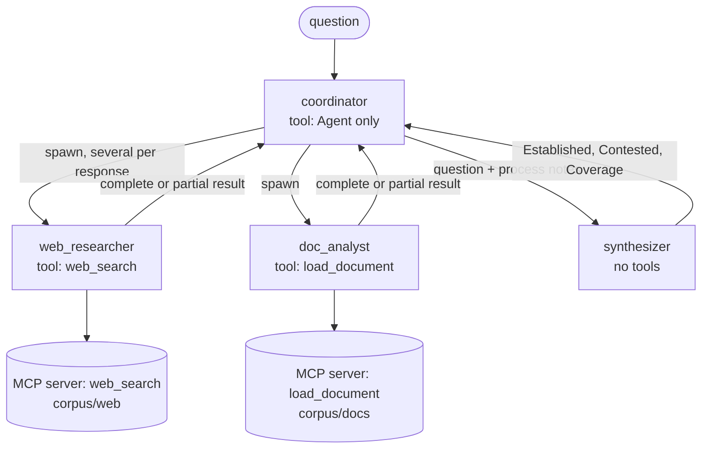

# Exercise 3: multi-agent research pipeline

A coordinator on the Claude Agent SDK answers a market research question ("How big was
the EU EV battery recycling market in 2025, and how fast has it grown?") by delegating
to subagents. It runs over a small local corpus of fictional web pages and reports,
so runs are repeatable and cost only model tokens. Each step adds one idea, and live
runs drove most of the design: the model plans and writes; hooks in code guarantee
permissions, formats and the hand-off of data.

## What it shows

- **Coordinator and subagents, hub and spoke.** The coordinator's only tool is the
  spawn tool (`Agent`; the exam calls it `Task`). Two researchers own one tool each, a
  synthesizer has none. Subagents never talk to each other.
- **Least privilege that holds.** Each researcher gets its own MCP server process that
  registers only its tool. A PreToolUse hook allows each research tool for its owner
  only. `AgentDefinition.tools` alone did not hide a shared server's other tool.
- **Parallel execution, measured.** Independent subagents are spawned in one
  response. Timings per phase show where the time actually goes.
- **Errors as data.** Injected timeouts come back as structured MCP errors
  (`transient`, `isRetryable: true`). Researchers retry once, then hand back a partial
  result with what they tried and what to try next. An empty search is a finding.
- **Hand-backs validated at the source.** A SubagentStop hook checks every
  researcher's result against the schema and sends a broken one back once, with each
  error as field and problem. It never loops.
- **Data passed in code, not copied by the model.** A PreToolUse hook attaches every
  recorded finding to the synthesizer's prompt. Asking the coordinator to copy 50
  findings failed in every live run.
- **Conflicts kept visible.** The report has fixed sections: Established, Contested
  (figures side by side with source, date, scope and the likely reason they differ)
  and Coverage (what is well supported, what is missing and why).
- **Silent degradation made visible.** The run prints every tool error, partial or
  invalid hand-back and empty search from the trace, and flags a degraded run whose
  answer has no Coverage section.

## Architecture



| Hook | Event | Does |
|---|---|---|
| `allow_owner_only` | PreToolUse, research tools | allows a tool for the subagent that owns it, denies everyone else |
| `keep_in_foreground` | PreToolUse, spawn tool | turns a background spawn into a foreground one, so results come back as the tool result |
| `attach_findings` | PreToolUse, spawn tool | appends every recorded finding to the synthesizer's prompt |
| `record_findings` | PostToolUse, spawn tool | records every finding a researcher hands back |
| `validate_handback` | SubagentStop | sends an invalid hand-back back once with its errors; marks the retry `passed` or `format_failed` |

## The steps

| Step | Adds | Main files |
|---|---|---|
| 1 | The corpus, an MCP server with two constrained tools, a coordinator with two single-tool subagents, structured findings | `server.py`, `agent.py`, `corpus/` |
| 2 | Parallel vs sequential spawning, a tool-less synthesizer that cites a source on every claim, typed sources, per-phase timings | `agent.py`, `findings.py`, `timeline.py` |
| 3 | Failure injection, structured transient errors, partial results, empty searches as findings, a Coverage section, degradation read from the trace | `faults.py`, `findings.py`, `timeline.py` |
| 4 | Hand-back validation on SubagentStop, findings attached in code, Established / Contested / Coverage report sections | `validation.py`, `completeness.py` |

## Design decisions

| Decision | Why |
|---|---|
| The coordinator has only the spawn tool | It can't search or read, so every fact in the answer comes through a subagent's findings. |
| Each researcher gets its own server with only its tool | In a live run, `AgentDefinition.tools` did not stop `web_researcher` from calling `load_document` on a shared server. A tool the server never registers can't leak. The hook stays as a second check. |
| `load_document(doc_id)` instead of a general `fetch_url` | The ID must match `^[a-z0-9-]+$` and resolve inside `corpus/docs`; paths, URLs and symlinks out are rejected with the list of valid IDs. |
| One typed source per finding (`source_type` + `source_id`) | Free text drifted in live runs (`"url (report doc_id: …)"`, `"url ; url"`). The schema now rejects both. |
| Results are a union on `status`: `complete` or `partial` | A partial result says what failed, every query tried, what was found and what to try next. Errors name the branch: `partial.suggested_alternatives: Field required`. |
| An empty search is a finding (`source_type: "search"`) | "No sources found for X" is information. Treating it as an error makes agents retry pointlessly or give up. |
| Transient errors are retried once, by the subagent | The subagent has the context; the coordinator decides only what to do with the gap. |
| Hand-backs are validated on SubagentStop, blocked at most once | The subagent fixes its own output while it still has the context. A second invalid hand-back goes through as `format_failed`, so it can't loop. |
| Findings reach the synthesizer through code | A model can't copy 50 findings exactly. In live runs one excerpt changed every time and every synthesis was denied. The coordinator now writes only the question, emphasis and process notes. |
| The output format lives in the subagent definitions | Coordinators kept dictating their own fields to subagents. Each researcher's description now says to ask it for facts, never a format, and its prompt says its own format wins. |
| Verification against a report is a quality criterion, not a fixed step | "Headline figures must be verified against the primary report whenever a finding cites a doc_id." The coordinator decides when, so a question with no report behind it costs no extra spawn. |
| Established needs two independent sources or a primary report | A press page and the report it summarizes count as one source. |
| Contested figures stand side by side, never averaged | €1.9 billion and €3.4 billion measure different markets. Averaging them would invent a number no source states. |
| A spawn's background flag is overridden | The CLI can start subagents in the background, returning "Async agent launched" instead of findings. That breaks the explicit hand-off. |

## Example: the Contested section from a live run

| Measure | 2025 | 2024 | Growth | Source, date, scope |
|---|---|---|---|---|
| Nordwell Research | €1.9bn | €1.6bn | +19% | nordwell-eu-outlook-2026, 2026-02-11. EU-27, EV lithium-ion only, processing revenue, excludes recovered-metal resale |
| EBCA | €3.4bn | €2.9bn | +18% | ebca-circularity-report-2025, 2026-03-04. EU-27 + EFTA + UK, all lithium-ion feedstock, includes recovered-metal value |

> **Reason for the gap.** The two figures differ in geography, feedstock and value
> basis. The sources don't quantify how much each factor contributes.

The same run's Coverage section listed the gaps with their cause: no actual 2022 or
2023 value exists in any source, so growth since 2022 can't be computed; the 2022
figure is an old forecast; a blog's "over €10 billion" is excluded as unsourced.

## Run it

Set up the repo first (see the [main README](../README.md#quickstart)). These commands
call the real API; one run costs a few cents with Haiku.

```bash
Q="How big was the EU EV battery recycling market in 2025, and how fast has it grown since 2022?"
uv run python -m ex3_research.agent --mode parallel "$Q"                 # one run, full report
uv run python -m ex3_research.agent "$Q"                                 # parallel and sequential, timings compared
uv run python -m ex3_research.agent --runs 3 "$Q"                        # per-phase timing table over 3 runs per mode
uv run python -m ex3_research.agent --mode parallel --fail archive-down "$Q"  # inject a failure
```

`--fail` takes `timeout-once` (each searcher's first call times out),
`archive-down` (every news-archive search times out) or `empty-once` (the first call
returns nothing). It then also prints each tool error, each hand-back's status and
the Coverage section. `--verbose` adds every subagent's prompt, tool calls and raw
hand-back.

The tests (`tests/test_ex3_*.py`) run offline against scripted message streams. Two
broken hand-backs captured from a live run are fixtures for the validation hook.

## The corpus

Eight web pages (`corpus/web/`) and three longer reports (`corpus/docs/`), all
fictional, on `example.com` domains.

| Source | What it is | Its role |
|---|---|---|
| Nordwell Research press page + report | €1.9bn, EU-27, EV only, processing revenue | one side of the conflict |
| EBCA news page + report | €3.4bn, EU-27 + EFTA + UK, all lithium-ion, metal value included | the other side |
| Institute for Circular Mobility study | tonnage and capacity, no market value | context; no shortcut that reconciles the two figures |
| 2022 forecast (news archive) | €1.2bn by 2025 | outdated |
| 2024 black mass prices (news archive) | payables fell from 75% to 55% | context on metal prices |
| promotional blog | "over €10 billion" | unsourced, to be excluded |
| plant tracker, end-of-life volumes, regulation summary | capacity, tonnage, recycling targets | low-confidence context |

## Code

| Module | What it does |
|---|---|
| `agent.py` | Prompts, subagent definitions, the permission and foreground hooks, options, CLI |
| `server.py` | MCP server: `web_search` (with a news-archive category) and `load_document` |
| `faults.py` | `EX3_FAIL` failure plans for `web_search` |
| `findings.py` | `Finding`, `NoSources`, complete and partial results, parsing hand-backs, citations |
| `completeness.py` | Hooks that record findings and attach them to the synthesizer's prompt |
| `validation.py` | SubagentStop hook: send an unusable hand-back back once |
| `timeline.py` | Reads the message stream: spawns, timings, concurrency, phases, failures, report sections |
