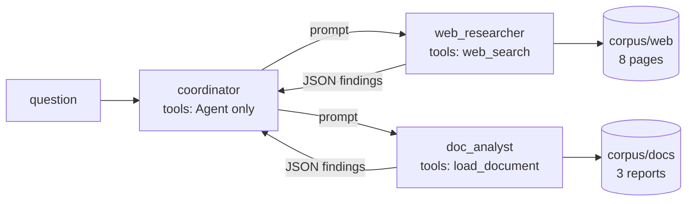
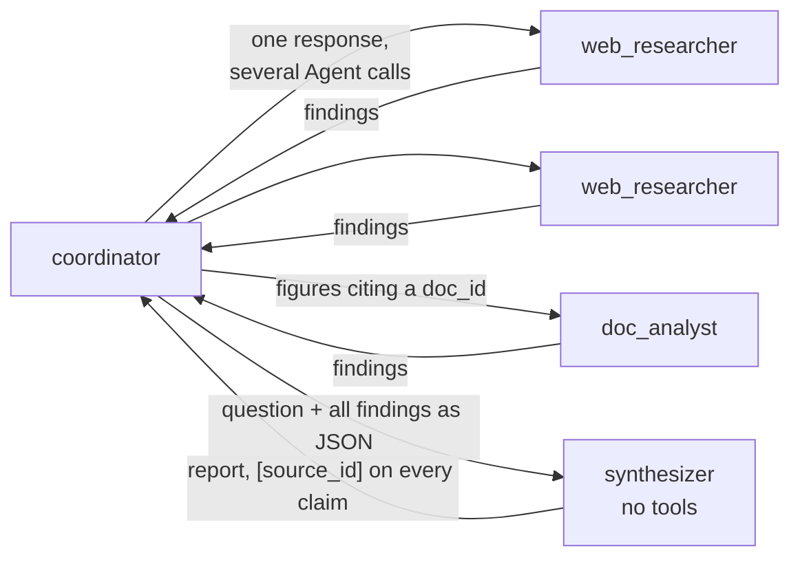
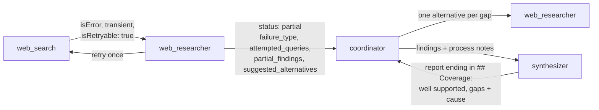

# Exercise 4: multi-agent research pipeline

A coordinator agent on the Claude Agent SDK researches "EU EV battery recycling market
2024–2026" by delegating to subagents. It runs over a small local fake corpus, not
the real web, so runs are repeatable and cost only model tokens.

## Steps

1. Coordinator, two subagents, structured findings
2. Parallel subagents, explicit hand-off, synthesis
3. Error propagation and partial results
4. Hand-back validation and conflicting sources
5. Quiz

## Step 1: coordinator, two subagents, structured findings



- **Corpus** (`corpus/`): 8 fictional web pages (`url`, `title`, `published`, `text`)
  and 3 longer reports (`doc_id`, `title`, `published`, `text`). Two credible sources
  disagree on the 2025 market size because they measure different things: Nordwell
  Research says EUR 1.9 billion (EU-27, EV processing revenue only), the EBCA says
  EUR 3.4 billion (EU-27 + EFTA + UK, all lithium-ion, including recovered metal
  value). The corpus also has an outdated 2022 forecast and an unsourced promotional
  blog. Step 4 builds on this.
- **MCP server** (`server.py`): `web_search(query)` returns up to 5 matching pages;
  no match is an empty list, not an error. `load_document(doc_id)` reads only from
  `corpus/docs`: the id must be lowercase letters, digits and hyphens, and the file
  must resolve to directly inside the library, so paths, URLs and symlinks out are
  rejected with an error that lists the valid ids. It is a constrained tool, not a
  general `fetch_url`.
- **Subagents** (`agent.py`): `web_researcher` sees only `web_search`, `doc_analyst`
  sees only `load_document`. Their system prompts state goals and quality criteria,
  and ask for a JSON array of findings, validated by the `Finding` model
  (`findings.py`; Step 2 split `source` into `source_type` and `source_id`).
- **Coordinator**: its only tool is `Agent`, the subagent-spawning tool. The exam
  calls it `Task`; claude-agent-sdk 0.2.172 calls it `Agent` and still accepts `Task`
  as an alias. The MCP server is attached to the subagents, not the coordinator, so
  the coordinator never sees the research tools.
- **Permissions**: `allowed_tools` is `["Agent"]` only. A PreToolUse hook approves
  each research tool for the subagent that owns it and denies it for anyone else,
  using the hook input's `agent_type`.
- **What the live runs showed**: `AgentDefinition.tools` did not hide the other tool
  of a shared server (`web_researcher` called `load_document`; the hook denied it).
  Each subagent now gets its own server process started with only its tool
  (`python -m ex4_research.server web_search`), and the hook stays as a second check.

## Step 2: parallel subagents, explicit hand-off, synthesis



- **Verification as a goal, not a step.** The coordinator's prompt has a quality
  criterion: "Headline figures must be verified against the primary report whenever
  a finding cites a doc_id; delegate that to doc_analyst." It never says "always run
  doc_analyst". Step 1's run 2 skipped the reports entirely; this criterion is the fix.
- **One source per finding, enforced.** `source_type` is `web` or `doc`; `source_id`
  must be one http(s) URL for `web` and one doc_id for `doc`. Live runs had returned
  `"url (report doc_id: ...)"` and `"url ; url"`; both are now rejected. The timeline
  also flags a researcher that returns the other source type.
- **Parallel vs sequential** (`--mode`). Only one line of the coordinator's prompt
  differs: parallel says independent subtasks must be spawned in the same response,
  as several Agent tool calls; sequential says one Agent call per response. Prompt
  rules are not guarantees, so the timeline measures what happened: which
  coordinator response spawned each subagent, and how many ran at once.
- **Explicit hand-off.** Subagents never talk to each other. The coordinator passes
  everything on in prompts, including every finding, merged into one JSON array,
  in the synthesizer's prompt.
- **Synthesizer** (no tools, one turn): writes the report from the findings only,
  with `[source_id]` on every claim. Code checks the citations against the findings
  it was given: invented source_ids and sources never cited are reported.
- **Complete hand-off** (`completeness.py`). A PostToolUse hook on the spawn tool
  records every finding a researcher hands back. In Step 2 a PreToolUse hook denied
  a synthesizer prompt that was missing any of them; Step 4 replaced that (see below).
- **Timing per phase** (`--runs N`): web research, doc verification, synthesis,
  coordinator-only time (no subagent running) and total, as mean (min-max) per mode,
  with the number of spawns per run.
- **What the live runs showed**:
  - The coordinator dictated its own output fields to subagents (`value`,
    `doc_id`), and every findings list failed the schema. It is now told to ask for
    facts, not formats, and the findings format says it is fixed.
  - In sequential mode the coordinator started subagents with `run_in_background`:
    the spawn tool returned "Async agent launched" at once and the findings came
    later as notifications. A PreToolUse hook on the spawn tool now rewrites the
    input to run in the foreground, and the timeline marks spawns that asked.
  - Asked for one merged JSON array, the coordinator still passed one array per
    subagent, so the checker reads every array.
  - The two modes split the work differently (parallel: 2 web + 2 doc researchers;
    sequential: 1 web + 2 doc), so wall-clock alone does not compare them. The
    timeline also prints subagent work time against elapsed time.

Run it (costs money; `--mode both` is the default and runs the modes one after the
other):

```bash
uv run python -m ex4_research.agent "How big was the EU EV battery recycling market in 2025, and how fast is it growing?"
uv run python -m ex4_research.agent --mode parallel --verbose "..."
```

Per mode it prints the spawn timeline (seconds since start, spawn and hand-back of
each subagent, findings status, peak concurrency), the synthesizer's prompt
(shortened), the final report with the citation check, and the cost; then both
wall-clock times. `--verbose` adds each subagent's prompt, tool calls and raw
hand-back.

## Step 3: error propagation and partial results



- **Failure injection** (`faults.py`, `EX4_FAIL` in the server's environment, or
  `--fail` on the CLI):
  - `timeout-once` (`timeout_once`): each web_search server's first call times out;
    the same query again works.
  - `archive-down` (`category_timeout:news archive`): every search of the news
    archive category times out. `web_search` gained a `category` parameter
    (`current` or `news archive`) and two old news pages moved to the archive.
  - `empty-once` (`empty_once`): the first call returns a valid empty result.
- **Structured errors**: a timeout is an MCP error result with
  `errorCategory: transient` and `isRetryable: true`, like Exercise 1's backend timeout.
- **Researchers** retry a transient error once, locally. If it still fails they hand
  back `{"status": "partial", "failure_type", "attempted_queries",
  "partial_findings", "suggested_alternatives"}` instead of crashing; otherwise
  `{"status": "complete", "findings"}`. An empty search is a finding of its own
  (`source_type: "search"`, "No sources found for ..."), not an error.
- **Coordinator** continues with partial results, never aborts, may try one
  alternative per gap, and passes process notes to the synthesizer. If the
  synthesizer cannot run or a failure is not in the report, its answer says so first.
- **Synthesizer** ends the report with `## Coverage`: well-supported conclusions and
  gaps with their cause.
- **Silent degradation becomes visible in code, too**: `--fail` prints every tool
  error as returned, each hand-back's status, the coordinator's own text between
  steps, the degradation read from the trace (tool errors, partial or invalid
  hand-backs, empty searches, denials, a missing synthesizer) and the Coverage
  section, and flags a run that degraded without one.

```bash
uv run python -m ex4_research.agent --mode parallel --fail archive-down "How big was the EU EV battery recycling market in 2025, and how fast has it grown since 2022?"
```

## Step 4: hand-back validation and conflicting sources

The conflict itself was already handled in Steps 2 and 3: the coordinator kept
EUR 1.9 billion (Nordwell: EU-27, EV only, processing revenue) and EUR 3.4 billion
(EBCA: EU-27 + EFTA + UK, all lithium-ion, metal value included) apart by scope
instead of averaging them. Step 4 makes that structure explicit and closes the
format gap Step 3 exposed.

- **Hand-back validation hook** (`validation.py`, on the `SubagentStop` event, which
  claude-agent-sdk 0.2.172 calls that). When a researcher stops, the hook parses its
  last message against the result schema (complete with findings, or partial with
  `failure_type`, `attempted_queries`, `partial_findings`, `suggested_alternatives`)
  and checks each sourced finding has its own tool's `source_type`. If it is
  invalid, the hook blocks the stop once and sends back every error as field and
  problem, for example `partial.suggested_alternatives: Field required`. The second
  hand-back is always let through: it either passes or is marked `format_failed` in
  the trace. Stops are paired by `agent_id`, so a subagent is never blocked twice
  and can never loop. `--save-handbacks FILE` keeps the raw blocked hand-backs.
- **Report structure.** The synthesizer's report has three fixed sections:
  `## Established` (claims backed by at least two independent sources or by a
  primary report; a press page and the report it summarizes count as one),
  `## Contested` (conflicting figures side by side, each with source, date and
  scope, plus the likely reason they differ; never averaged, never one dropped) and
  `## Coverage` (as in Step 3). The run reports which sections are present.

- **Findings injected in code, not copied by the model.** With the Step 2 hook,
  live runs denied every synthesizer spawn: the coordinator had to copy 47 to 55
  findings word for word, and one excerpt always changed. Now the PreToolUse hook
  rewrites the synthesizer's prompt: the coordinator writes the question, what
  matters most and its process notes; code attaches every recorded finding as
  JSON. The hand-off is complete by construction.
- **The output format lives in the subagent definitions.** Live coordinators kept
  dictating their own fields (`claim_checked`, `verified`, ...) to doc_analyst. The
  coordinator's prompt no longer mentions formats; each researcher's description,
  which is what the coordinator reads about it, says it returns its own fixed
  format and must be asked for facts only, and its prompt says the format wins over
  any request. The validation hook enforces it.

## Code and tests

| Module | What it does | Tests |
|---|---|---|
| `server.py` | MCP server: `web_search`, `load_document` | `tests/test_ex4_server.py` |
| `faults.py` | `EX4_FAIL` failure plans for web_search | `tests/test_ex4_faults.py` |
| `findings.py` | `Finding`, `NoSources`, complete/partial results, parsing, citations | `tests/test_ex4_findings.py` |
| `completeness.py` | Hooks: record findings, deny an incomplete synthesizer hand-off | `tests/test_ex4_completeness.py` |
| `validation.py` | SubagentStop hook: send an unusable hand-back back once | `tests/test_ex4_validation.py` |
| `timeline.py` | Reads the message stream: spawns, times, concurrency, phases, report | `tests/test_ex4_timeline.py` |
| `agent.py` | Prompts, subagents, permission hook, options, CLI | `tests/test_ex4_agent.py` |
